<p align="center">
  
</p>

# github-readme-svg

[English](README.md) | **한국어**

GitHub 프로필/저장소 README에 넣을 **애니메이션 SVG 배너** 생성기입니다.
JavaScript 없이 CSS 애니메이션과 SMIL만 써서 GitHub에서 그대로 재생됩니다.
CSS로 움직이는 부분은 `prefers-reduced-motion` 설정에서 멈춥니다 (SMIL 애니메이션은 CSS로 멈출 수 없어 계속 재생됩니다).

## GitHub Action / Marketplace

Nix나 별도 Python 패키지 설치 없이 다른 저장소의 워크플로에서 사용할 수 있습니다.
아래 내용을 `.github/workflows/readme-svg.yml`로 저장하고 README에
``를 추가하세요. 커밋 단계에는 대상 브랜치에 대한
푸시 권한이 필요하며, 브랜치 보호 규칙도 적용됩니다.

> `@v1`은 첫 릴리스와 버전 태그를 게시한 후 사용할 수 있습니다.
> 게시 전에는 `action.yml`이 포함된 커밋 SHA를 지정하여 시험할 수 있습니다.

```yaml
name: Update README banner
on:
  workflow_dispatch:
  schedule:
    - cron: '0 0 * * *'
permissions:
  contents: write
concurrency:
  group: readme-svg
  cancel-in-progress: false
jobs:
  generate:
    runs-on: ubuntu-latest
    steps:
      - uses: actions/checkout@v4
      - uses: jihoo12/github-readme-svg@v1
        id: svg
        with:
          style: synthwave
          name: Hi, I'm Jihoo
          lines: |
            I build things with Python
            Welcome to my GitHub!
          tags: |
            Python
            Rust
          output-dir: assets
      - name: Commit generated SVG
        run: |
          git config user.name "github-actions[bot]"
          git config user.email "41898282+github-actions[bot]@users.noreply.github.com"
          git add assets/synthwave.svg
          if ! git diff --cached --quiet; then
            git commit -m "chore: update README SVG"
            git push
          fi
```

기여 그래프는 `style: contrib-city`, `user: ${{ github.repository_owner }}`를
지정하세요. `palette: neon`처럼 색상을 선택할 수 있습니다.
커밋 경로도 `assets/contrib-city.svg`로 변경해야 합니다.
`style: all`은 배너 18종을 생성하며, `user`를 지정하면 기여 그래프 4종도 생성합니다.
이때 커밋 단계에서 게시할 생성 파일들을 선택하세요.

| 입력 | 기본값 | 설명 |
|---|---|---|
| `style` | `banner` | 아래 스타일 이름 또는 `all` |
| `name` | `Hi, I'm Jihoo` | 큰 제목 |
| `lines` | CLI 예제 문구 | 한 줄에 하나씩 입력하는 부제목 |
| `tags` | CLI 예제 태그 | 한 줄에 하나씩 입력하는 기술 태그 |
| `theme` | `aurora` | `aurora`, `sunset`, `ocean` |
| `seed` | `42` | 난수 시드 정수 |
| `user` | 없음 | 기여 그래프에 필요한 GitHub 사용자 이름 |
| `palette` | `green` | `green`, `halloween`, `ice`, `neon` |
| `contrib-html` | 없음 | 오프라인 생성에 사용할 기여 HTML 파일 |
| `output-dir` | `assets` | SVG 출력 디렉터리 |
| `out` | 없음 | 단일 SVG 파일 경로. `output-dir`보다 우선하며 `all`과 함께 사용 불가 |

경로는 체크아웃된 저장소 기준이며 절대 경로도 지원합니다.
`files` 출력은 생성된 SVG 절대 경로의 JSON 배열입니다.
Bash 및 `actions/setup-python`을 지원하는 Linux, macOS, Windows 러너에서 사용할 수 있습니다.
Action은 파일을 생성하며, 커밋 여부는 호출하는 워크플로가 결정합니다.
공개 기여 데이터를 가져오는 데 GitHub 토큰은 필요하지 않습니다.

관리자용 [Marketplace 게시 절차](MARKETPLACE.md)를 참고하세요.


## 스타일

### `synthwave`
네온 타이틀이 선으로 그려진 뒤 빛나며 깜빡이고, 레트로 줄무늬 태양과 다가오는 원근 그리드가 배경에 깔립니다.


### `matrix`
깊이감 있는 코드 비, RGB가 갈라지는 글리치 타이틀, 타이핑 효과 부제목.


### `orbit`
기술 스택 태그가 이름 주위를 3D 궤도로 돌고, 뒤로 갈수록 작고 흐려집니다. 가운데에는 맥동하는 코어가 있습니다.


### `banner`
그라디언트 타이틀, 여러 문구를 번갈아 타이핑하고 지우는 효과, 반짝이는 별, 떠다니는 원, 흘러가는 물결.


### `splitflap`
공항 출발 안내판 같은 스플릿 플랩 보드입니다. 칸마다 무작위 글자를 촤라락 넘기다가 제자리에 멈추고,
넘길 때마다 윗장이 경첩 위로 떨어집니다. 이름은 한 바퀴마다 새로 넘어가고, 아래 줄은 `--line`을 차례로 보여줍니다.
글자가 바뀌지 않는 칸은 실제 보드처럼 가만히 있습니다. 헤더에는 앞쪽 태그들이 표시됩니다.


### `swarm`
밤 풀밭 위를 떠다니던 반딧불이들이 모여 빛나는 점으로 이름을 쓰고, 잠시 머물다 다시 흩어집니다.
앞뒤의 풀이 바람에 흔들립니다.


### `liquid`
이름이 녹은 금속이 됩니다. 출렁이는 웅덩이에서 방울이 솟아올라 글자에 녹아들고, 다시 아래로 뚝뚝 떨어집니다.
액체 표면에는 움직이는 반사광이 있습니다 (gooey 필터 + SVG 라이팅).


### `scope`
CRT 오실로스코프입니다. 전자빔이 형광 선으로 이름을 한 획씩 쓰고, 아래 파형은 사인·사각·심전도·AM 파형으로
모양을 바꿉니다. 노브가 움찔거리고 트리거 LED가 깜빡입니다. `--theme`으로 형광색을 고릅니다: `aurora` 초록, `sunset` 호박색, `ocean` 청록.


### `blueprint`
설계 도면입니다. 보조선을 먼저 긋고, 펜 플로터가 이름을 그린 다음, 치수선과 "DETAIL A" 표시가 붙습니다.
표제란에는 이름과 첫 번째 문구가, 아래쪽에는 태그가 들어갑니다.


### `terminal`
터미널 창입니다. 프롬프트에 `neofetch`가 입력되면 나에 대한 시스템 정보 카드가 한 줄씩 출력됩니다.
핸들 첫 글자의 픽셀 아트, 이름, 문구, 스택, 색상 막대가 나오고 깜빡이는 커서로 끝납니다.


### `borealis`
산속 호수 위의 오로라입니다. 세 겹의 오로라 커튼이 빛줄기와 함께 일렁이고, 별이 반짝이고, 가끔 유성이 지나갑니다.
모든 것이 잔물결 치는 호수에 비칩니다.


### `hologram`
홀로그램 ID 카드입니다. 프로젝터 위에서 지오데식 와이어프레임 구가 회전하고(앞쪽 모서리는 밝게, 뒤쪽은 흐리게),
궤도 고리와 스캔 빔이 감싸며 가끔 지직거립니다. 옆에는 이름, 첫 번째 문구, 태그가 표시됩니다.


### `circuit`
회로 기판입니다. 신호 펄스가 구리 배선을 따라 이름이 새겨진 칩으로 달려가고, 펄스가 도착할 때마다 핀이 빛납니다.
태그는 실크스크린 라벨로 인쇄됩니다.


### `warp`
초공간 점프입니다. 중앙에서 별빛 줄기가 쏟아져 나오고, 이름이 줌인해 머물다가 섬광과 함께 화면 밖으로 날아갑니다.
HUD 프레임에는 태그가 목적지로 표시됩니다.


### `equalizer`
"Now playing" 카드입니다. 앨범 커버에서 레코드가 빠져나와 돌고, 스펙트럼 이퀄라이저가 반사와 함께 튀며,
진행 바와 시계가 4:00짜리 곡을 실제로 흘러갑니다. 이름이 곡 제목, 첫 번째 문구가 아티스트입니다.


### `sakura`
해 질 녘의 벚꽃입니다. 꽃이 가득 핀 가지가 달 앞에서 살랑이고, 꽃잎이 뒤집히며 떨어져 언덕에 쌓입니다.
몇 초마다 바람이 불어 꽃잎 무리가 화면을 가로지릅니다. 이름은 한 글자씩 피어나고, 옆에 첫 글자가 새겨진 붉은 낙관이 찍힙니다.


### `seishun`
애니메이션 같은 청춘의 여름입니다. 빛줄기가 도는 태양과 렌즈 플레어 아래로 뭉게구름이 흘러가고, 비행기가 하늘에
비행운을 그리고, 종이비행기가 학교 옥상 펜스 위에서 한 바퀴 돕니다. 이름은 "青春" 배지와 함께 굵은 타이틀로 튀어나오고,
첫 번째 문구는 아래 리본에 들어갑니다. `--theme sunset`이면 노을 진 하늘이 됩니다.


### `abyss`
심해입니다. 빛을 내는 해파리들이 촉수를 늘어뜨린 채 이름 주위에서 박동하고, 이름은 물속에서 보는 것처럼 일렁입니다.
수면에서 빛줄기가 스며들고, 바다눈이 가라앉고, 물방울이 떠오르고, 초롱아귀가 빛나는 미끼를 달고 지나갑니다.
문구는 차례로 교차하며 나타나고, 태그는 해저를 따라 놓이며, 오른쪽에는 수심 게이지가 있습니다.



## Contribution graph 스타일

실제 GitHub contribution 기록으로 만듭니다. 데이터는 공개 페이지 `github.com/users/<user>/contributions`에서 가져오므로 토큰이 필요 없습니다.
총 기여 수, 연속 기록, 최고 기록일을 숫자가 올라가는 애니메이션으로 보여줍니다.

### `contrib-grid`
익숙한 잔디 그리드입니다. 칸들이 대각선 물결로 튀어나온 뒤, 스캔 빔이 지나가며 빛의 잔상을 남깁니다.



### `contrib-city`
1년을 3D 도시로 보여줍니다. 하루가 건물 하나이고 높이는 그날 기여 수를 따르며, 도시가 물결처럼 솟아오릅니다.



### `contrib-galaxy`
1년을 회전하는 나선 은하로 보여줍니다. 하루가 두 팔 중 하나 위의 별 하나이고, 1년 전은 가장자리에, 오늘은
빛나는 중심에 있습니다. 밝기는 그날 기여 수를 따르고, 가장 바빴던 날에는 십자 빛줄기가 생기며,
별들이 바깥에서 안쪽으로 날짜 순서대로 켜집니다.



### `contrib-heartbeat`
환자 모니터입니다. 한 주가 심장 박동 한 번이고, 스파이크 높이는 그 주의 기여 수를 따릅니다. 쉰 주는 평탄선이 됩니다.
실제 모니터처럼 일정한 속도로 밝은 점이 지나가며 앞을 지우고, 옆에는 주간 평균·총합·연속 기록·최고 기록일이 표시됩니다.



팔레트: `--palette green | halloween | ice | neon`

```sh
nix run . -- --style contrib-grid --user <GitHub-사용자-이름>
nix run . -- --style contrib-city --user <GitHub-사용자-이름> --palette neon
nix run . -- --style contrib-galaxy --user <GitHub-사용자-이름> --palette ice
nix run . -- --style contrib-heartbeat --user <GitHub-사용자-이름>
```

### GitHub Actions로 자동 갱신

`.github/workflows/contrib.yml`은 `main`에서 지정된 생성기 파일이 변경되면 Nix로 contrib SVG들을 다시 만들고, 바뀐 게 있으면 커밋합니다. 이 저장소에서는 정기 갱신을 실행하지 않습니다.
사용자 이름은 저장소 소유자로 정해집니다. **Actions** 탭에서 **Run workflow**로 직접 실행할 수도 있습니다.
**Settings → Actions → General → Workflow permissions → Read and write** 설정이 필요합니다.

## 사용법 (Nix)

```sh
# 모든 스타일을 assets/에 생성
nix run . -- --style all --name "Hi, I'm Jihoo"

# 스타일 하나만
nix run . -- --style orbit --name "Jihoo" \
  --line "Full-stack tinkerer" \
  --tag Python --tag Nix --tag Rust --tag Linux

nix run . -- --style matrix \
  --line "Welcome to my GitHub!" --line "I love building cool stuff"

# 개발 셸 (python3 + rsvg-convert)
nix develop
python3 generate.py --help
```

| 옵션 | 설명 | 기본값 |
|---|---|---|
| `--style` | `banner` · `synthwave` · `matrix` · `orbit` · `splitflap` · `swarm` · `liquid` · `scope` · `blueprint` · `terminal` · `borealis` · `hologram` · `circuit` · `warp` · `equalizer` · `sakura` · `seishun` · `abyss` · `contrib-grid` · `contrib-city` · `contrib-galaxy` · `contrib-heartbeat` · `all` | `banner` |
| `--user` | `contrib-*` 스타일용 GitHub 사용자 이름 (`all`과 함께 쓰면 contrib 스타일도 생성) | — |
| `--palette` | `green` · `halloween` · `ice` · `neon` (`contrib-*`) | `green` |
| `--contrib-html` | 가져오는 대신 저장해 둔 contributions HTML 사용 | — |
| `--name` | 큰 타이틀 | `Hi, I'm Jihoo` |
| `--line` | 부제목 문구, 여러 번 지정 가능 (`banner`/`matrix`/`splitflap`은 모두 사용, 나머지는 첫 줄만 사용) | 예시 문구 3개 |
| `--tag` | 태그, 여러 번 지정 가능 (`orbit`은 궤도로 돌리고 `splitflap`/`blueprint`/`terminal`/`hologram`/`circuit`/`warp`/`equalizer`는 글자로 표시) | Python, Nix, Linux, … |
| `--theme` | `aurora` · `sunset` · `ocean` (`banner`, `orbit`, `splitflap`, `liquid`, `scope`, 그리고 `terminal`~`abyss`) | `aurora` |
| `--seed` | 별/코드 비 배치용 랜덤 시드 | `42` |
| `--out` | 출력 경로 (스타일 하나일 때만) | `assets/<style>.svg` |

## README에 넣기

생성한 SVG를 저장소에 커밋한 뒤 README에 다음을 넣으세요.

```html
<p align="center">
  
</p>
```

> `swarm`, `scope`, `blueprint`는 내장 단일 획 폰트(`vecfont.py`)로 이름을 그립니다. A–Z, 0–9와 흔한 문장부호를 지원하며,
> 소문자는 대문자로 그려지고 그 밖의 문자는 빈칸이 됩니다.

> `--line`, `--tag` 문구 폭은 글꼴 크기로 추정합니다. 영문이 가장 정확하고, 한글 등 전각 문자는 대략 맞습니다.
