<p align="center">
  
</p>

# github-readme-svg

**English** | [한국어](README.ko.md)

A generator for **animated SVG banners** to put in your GitHub profile or repository README.
No JavaScript: it uses only CSS animations and SMIL, so the banners play as-is on GitHub.
CSS-driven motion stops under `prefers-reduced-motion` (SMIL animations, which browsers cannot pause from CSS, keep playing).

## GitHub Action / Marketplace

Use this action in your own repository without installing Nix or Python dependencies.
Save the workflow below as `.github/workflows/readme-svg.yml` and add
`` to your README. The commit step requires permission
to push to the target branch; branch protection rules still apply.

> `@v1` becomes available after the first release and major-version tag are published.
> Before then, use a commit SHA containing `action.yml` to try the action.

```yaml
name: Update README banner
on:
  workflow_dispatch:
  schedule:
    - cron: '0 0 * * *'
permissions:
  contents: write
concurrency:
  group: readme-svg
  cancel-in-progress: false
jobs:
  generate:
    runs-on: ubuntu-latest
    steps:
      - uses: actions/checkout@v4
      - uses: jihoo12/github-readme-svg@v1
        id: svg
        with:
          style: synthwave
          name: Hi, I'm Jihoo
          lines: |
            I build things with Python
            Welcome to my GitHub!
          tags: |
            Python
            Rust
          output-dir: assets
      - name: Commit generated SVG
        run: |
          git config user.name "github-actions[bot]"
          git config user.email "41898282+github-actions[bot]@users.noreply.github.com"
          git add assets/synthwave.svg
          if ! git diff --cached --quiet; then
            git commit -m "chore: update README SVG"
            git push
          fi
```

For a contribution graph, set `style: contrib-city`, `user: ${{ github.repository_owner }}`,
and optionally `palette: neon`; update the commit path to `assets/contrib-city.svg`.
Use `style: all` to generate all 18 banner styles, plus the four contribution styles
when `user` is supplied, and stage the generated files you want to publish.

| Input | Default | Description |
|---|---|---|
| `style` | `banner` | Any style listed below, or `all` |
| `name` | `Hi, I'm Jihoo` | Banner title |
| `lines` | CLI sample lines | Subtitles, one per line |
| `tags` | CLI sample tags | Tags, one per line |
| `theme` | `aurora` | `aurora`, `sunset`, `ocean` |
| `seed` | `42` | Integer random seed |
| `user` | empty | Required for contribution styles |
| `palette` | `green` | `green`, `halloween`, `ice`, `neon` |
| `contrib-html` | empty | Saved contribution HTML file for offline generation |
| `output-dir` | `assets` | Directory for generated SVGs |
| `out` | empty | Single SVG path; overrides `output-dir`, incompatible with `all` |

Paths are relative to the checked-out repository; absolute paths also work.
The `files` output is a JSON array of absolute generated file paths.
Supports Linux, macOS, and Windows runners with Bash and `actions/setup-python` support.
The action generates files; committing them is controlled by your workflow.
No GitHub token is needed for public contribution data.

Maintainers: see [Marketplace publishing instructions](MARKETPLACE.md).


## Styles

### `synthwave`
A neon title that draws its own outline, then lights up and flickers. Behind it are a retro striped sun and a perspective grid that scrolls toward you.


### `matrix`
Falling code rain at several depths, a title with RGB-split glitches, and a typewriter subtitle.


### `orbit`
Your tech stack orbits your name in 3D-style ellipses, with tags shrinking and dimming as they pass behind. A pulsing core sits in the centre.


### `banner`
A gradient title, a typewriter effect that types and erases several lines in turn, twinkling stars, floating orbs and flowing waves.


### `splitflap`
An airport split-flap board. Every cell clatters through random letters before landing, the top flap
falling onto the hinge at each flip. The name refreshes once per loop and each `--line` takes a turn on the
lower row; cells that do not change stay still, like a real board. Your first tags go in the header.


### `swarm`
Fireflies drift over a night meadow, then swarm together to spell your name in glowing dots, hover for a
moment and scatter again. The grass sways in front of and behind them.


### `liquid`
Your name as molten metal. Blobs rise out of a sloshing pool, melt into the letters and drip back down, with
a moving specular highlight on the liquid surface (a gooey filter plus SVG lighting).


### `scope`
A CRT oscilloscope. The electron beam writes your name stroke by stroke in phosphor, while the trace below
morphs between sine, square, heartbeat and AM waveforms. Knobs twitch, the trigger LED blinks.
`--theme` picks the phosphor: `aurora` green, `sunset` amber, `ocean` cyan.


### `blueprint`
An engineering drawing. Construction lines are laid out first, a pen plotter draws your name, then it gets
dimensioned and called out as "DETAIL A". The title block holds your name and first line, the tags run along
the bottom.


### `terminal`
A terminal window. `neofetch` is typed at the prompt, then a system-info card about you prints line by line:
your handle's initial as pixel art, name, lines, stack and a colour strip, ending at a blinking cursor.


### `borealis`
Northern lights over a mountain lake. Three aurora curtains ripple and shimmer with drifting rays, the stars
twinkle, a meteor crosses now and then, and everything is mirrored in the rippling water.


### `hologram`
A holographic ID card. A geodesic wireframe globe spins above a projector (front edges bright, back edges dim),
wrapped in orbiting rings and a scan beam, with a glitchy flicker. Your name, first line and tags sit beside it.


### `circuit`
A circuit board. Signal pulses race along copper traces into a chip that carries your name, and each pin
lights up as a pulse arrives. Your tags are printed as silkscreen labels.


### `warp`
A jump to hyperspace. Star streaks rush out of the centre, your name zooms in, holds, then flies past the
viewer in a flash, inside a HUD frame that lists your tags as the destination.


### `equalizer`
A "now playing" card. A record spins out of the album sleeve, a spectrum equalizer bounces with a reflection,
and the progress bar and clock really tick through a 4:00 track. Your name is the title, the first line the artist.


### `sakura`
Cherry blossoms at dusk. Blossom-laden branches sway in front of a pale moon, petals tumble and flip as they fall
onto a petal-strewn hill, and every few seconds a gust of wind sweeps a stream of petals across. Your name
blooms in letter by letter next to a red seal stamped with your initial.


### `seishun`
Summer youth, anime style. Towering cumulus clouds drift under a sun with turning light rays and lens flare,
a jet draws a contrail across the sky, and a paper plane loops over a school-rooftop fence. Your name pops in
as a bold title with a "青春" badge, the first line on a ribbon below. `--theme sunset` gives a golden-hour sky.


### `abyss`
The deep sea. Bioluminescent jellyfish pulse and trail their tentacles around your name, which shimmers as if seen
through water, while light shafts fade in from the surface, marine snow sinks, bubbles rise and an anglerfish
swims past with its glowing lure. Subtitle lines cross-fade in turn, tags sit along the sea floor, and a depth
gauge runs down the right edge.



## Contribution graph styles

Built from your real GitHub contribution calendar, fetched from the public page `github.com/users/<user>/contributions` (no token needed).
They show total contributions, streaks and your best day, with numbers that count up.

### `contrib-grid`
The familiar grid. Cells pop in on a diagonal wave, then a scanning beam sweeps across and leaves a fading trail of light.



### `contrib-city`
Your year as a 3D city. Each day is a building whose height follows its contribution count, and the city rises in a wave.



### `contrib-galaxy`
Your year as a turning spiral galaxy. Each day is a star on one of two arms, a year ago at the rim and today
at the glowing core. Brightness follows the day's count, your busiest days get diffraction spikes, and the
stars ignite in date order from the rim inward.



### `contrib-heartbeat`
A patient monitor. Every week is one heartbeat whose spike is as tall as that week's contributions; idle weeks
flatline. The sweep moves at constant speed with a bright head and an erase gap, like a real monitor, next to
readouts for weekly average, total, streak and peak day.



Palettes: `--palette green | halloween | ice | neon`

```sh
nix run . -- --style contrib-grid --user <your-github-username>
nix run . -- --style contrib-city --user <your-github-username> --palette neon
nix run . -- --style contrib-galaxy --user <your-github-username> --palette ice
nix run . -- --style contrib-heartbeat --user <your-github-username>
```

### Auto-update with GitHub Actions

`.github/workflows/contrib.yml` regenerates the contrib SVGs using Nix when the configured generator files change on `main`, and commits them if they changed. This repository does not run scheduled SVG updates.
It uses the repository owner as the username. You can also run it by hand from the **Actions** tab (**Run workflow**).
It needs **Settings → Actions → General → Workflow permissions → Read and write**.

## Usage (Nix)

```sh
# Generate every style into assets/
nix run . -- --style all --name "Hi, I'm Jihoo"

# A single style
nix run . -- --style orbit --name "Jihoo" \
  --line "Full-stack tinkerer" \
  --tag Python --tag Nix --tag Rust --tag Linux

nix run . -- --style matrix \
  --line "Welcome to my GitHub!" --line "I love building cool stuff"

# Dev shell (python3 + rsvg-convert)
nix develop
python3 generate.py --help
```

| Option | Description | Default |
|---|---|---|
| `--style` | `banner` · `synthwave` · `matrix` · `orbit` · `splitflap` · `swarm` · `liquid` · `scope` · `blueprint` · `terminal` · `borealis` · `hologram` · `circuit` · `warp` · `equalizer` · `sakura` · `seishun` · `abyss` · `contrib-grid` · `contrib-city` · `contrib-galaxy` · `contrib-heartbeat` · `all` | `banner` |
| `--user` | GitHub username for `contrib-*` (with `all`, also generates the contrib styles) | — |
| `--palette` | `green` · `halloween` · `ice` · `neon` (`contrib-*`) | `green` |
| `--contrib-html` | Use a saved contributions HTML page instead of fetching it | — |
| `--name` | Large title | `Hi, I'm Jihoo` |
| `--line` | Subtitle lines, repeatable (`banner`/`matrix`/`splitflap` use all of them; the others use the first) | 3 sample lines |
| `--tag` | Tags, repeatable (`orbit` orbits them; `splitflap`/`blueprint`/`terminal`/`hologram`/`circuit`/`warp`/`equalizer` print them) | Python, Nix, Linux, … |
| `--theme` | `aurora` · `sunset` · `ocean` (`banner`, `orbit`, `splitflap`, `liquid`, `scope` and the styles from `terminal` to `abyss`) | `aurora` |
| `--seed` | Random seed for stars / code rain | `42` |
| `--out` | Output path (single style only) | `assets/<style>.svg` |

## Adding it to your README

Commit the generated SVG to your repository, then add this to your README:

```html
<p align="center">
  
</p>
```

> `swarm`, `scope` and `blueprint` draw the name with a built-in single-stroke font (`vecfont.py`) that covers
> A–Z, 0–9 and common punctuation; lowercase is drawn as uppercase and other characters are left blank.

> Text width for `--line` and `--tag` is estimated from the font size. It is most accurate for English text; Korean and other wide characters are approximate.
